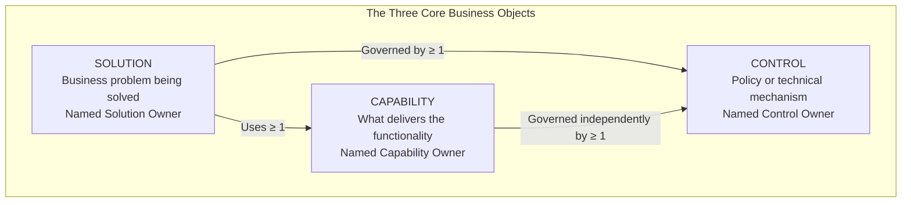
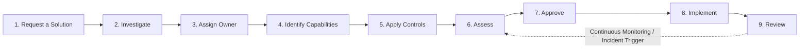

# AAIMS (AIMI) — Australian AI Management & Safety Interface
## Full Enterprise Architecture & Governance Specification (v1.0)

> **Regulatory Alignment**: Australian Government **National AI Centre (NAIC) Voluntary AI Safety Standard (VAISS — 10 Guardrails)** & ISO/IEC 42001  
> **Cryptographic Attestation Engine**: **BitBop (Qsecure)** Hardware Quantum Entropy & NIST FIPS 204 `ML-DSA-44` Post-Quantum Provenance (`https://api.bitbop.dev`)

---

## 1. Executive Purpose

**AAIMS (AI Management Interface / AIMI)** is a corporate governance, safety, and innovation management platform designed for organisations adopting artificial intelligence under the **Australian NAIC Voluntary AI Safety Standard**.

Most governance tools fail because they invent dozens of disconnected top-level tables (separate silos for policies, models, vendors, risk registers, datasets, projects, and committees) that obscure **who is accountable for what**. AAIMS enforces a strict, minimalist domain ontology: **there are exactly three core business objects (`SOLUTION`, `CAPABILITY`, `CONTROL`)**. Everything else is supporting metadata, lifecycle state, or cryptographically attested event history attached to those three objects and the organisational approval hierarchy.

---

## 2. The Core Domain Model (Strictly Three Business Objects)

| Core Object | Definition | Ownership |
| :--- | :--- | :--- |
| **`SOLUTION`** | The business-facing answer to a problem. This is what a business unit requests to have implemented. | **Named Solution Owner** (assigned by the AI Working Group based on business remit) |
| **`CAPABILITY`** | The functionality used to deliver a solution. Capabilities can be shared by multiple solutions. | **Named Capability Owner** |
| **`CONTROL`** | The policy or technical mechanism governing authorised use. Controls can be grouped and reused. | **Named Control Owner** |

### 2.1 Mandatory Structural Invariants

1. **Solution Completeness Invariant**: Every `SOLUTION` **must** reference at least one `CAPABILITY` and at least one `CONTROL` before it can be assessed, approved, or authorised for operation.
2. **Capability Authorisation Invariant**: No `CAPABILITY` may be authorised for operation (`status = "AUTHORISED"`) without at least one active, verified `CONTROL` governing it.
3. **Independent Capability Governance**: `CONTROL`s govern `CAPABILITY`s directly and independently of any particular `SOLUTION` that consumes that capability.
4. **Separation of Ownership**: The **Solution Owner** is accountable for the business outcome of the `SOLUTION`. That does **not** make them the owner of every `CAPABILITY` or `CONTROL` the solution uses; capability and control owners retain independent accountability for their respective components.
5. **No Entity Proliferation**:
   - A **Policy** is simply a `CONTROL` with `control_type = "POLICY"` (as distinct from `control_type = "TECHNICAL"`).
   - A **Control Package** (such as the *NAIC 10 Voluntary AI Safety Guardrails*) is a reusable grouping (`package_name` / tags) of `CONTROL`s.
   - Neither requires inventing a fourth top-level business object.

---

## 3. Supporting Information & Governance Records

All operational governance artefacts exist as structured records, state transitions, and cryptographic attestations associated with `SOLUTION`, `CAPABILITY`, `CONTROL`, and the Working Group:

- **Requests for Solutions** (initiating intake records attached to a `SOLUTION` in `REQUESTED` stage)
- **Working Group Meetings & Minutes** (structured meeting sessions advancing solutions through the 9-stage cycle)
- **Risk Assessments & Impact Ratings** (attached to `SOLUTION` and `CAPABILITY` records under NAIC Guardrail 2)
- **Evidence & Verification Tests** (attached to `CONTROL`s and `CAPABILITY`s under NAIC Guardrail 4)
- **Approvals & Escalations** (bound to a specific Working Group member's delegated authority)
- **Incidents, Breach Notifications & Remediations** (attached to the affected `SOLUTION` / `CAPABILITY` / `CONTROL`)
- **BitBop (Qsecure) Cryptographic Signatures & Attestations** (immutable `ML-DSA-44` post-quantum receipts anchoring every decision, request, approval, breach notification, remediation, and audit to the BitBop hardware entropy beacon chain)

---

## 4. Organisational Approval Hierarchy

1. **Board of Directors**:
   - Establishes the overarching AI Governance Charter and risk appetite (NAIC Guardrail 1).
   - Formally authorises the **Chief Executive Officer (CEO)** to charter and appoint the **AI Working Group**.
2. **AI Working Group**:
   - Appointed by the CEO. Each Working Group member is registered with:
     - **Name & Role**
     - **Organisational Function / Business Remit** (e.g., Customer Operations, Engineering & Data Platform, Cybersecurity & Privacy, Legal & Risk, Clinical/Financial Compliance)
     - **Domain Expertise**
     - **Delegated Approval Authority Tier** (`TIER_1_LOW`, `TIER_2_MEDIUM`, `TIER_3_HIGH_EXEC`, `BOARD_ESCALATION`)
3. **Working Group Triage & Investigation**:
   When a business unit submits a **Request for a Solution**, the Working Group investigates it during a meeting and determines:
   1. **Business Remit & Solution Ownership**: Whose business remit does this solution fall under? That Working Group member (or designated business leader) becomes the **Named Solution Owner**.
   2. **Required Capabilities**: Which existing `CAPABILITY`s are required, or what new capabilities must be registered? Their existing **Named Capability Owners** are identified, or ownership is assigned.
   3. **Applicable Controls & Gap Analysis**: Which policy and technical `CONTROL`s apply (including mandatory NAIC Guardrail controls)? Their **Named Control Owners** are identified, and any control gaps are flagged and addressed.
   4. **Approval Qualification & Escalation**: Who has the required expertise and delegated authority tier to approve the solution given its risk profile? The decision follows the approval hierarchy, escalating to Executive/Board authority where risk thresholds require it.

---

## 5. The 9-Stage Working Group Lifecycle

AAIMS guides the AI Working Group through a deterministic 9-stage lifecycle for every `SOLUTION`:

| Stage | Gate Requirements enforced by AAIMS | BitBop (Qsecure) Attestation Event |
| :--- | :--- | :--- |
| **1. Request a Solution** | Business unit submits problem statement, intended users, and business unit sponsor. | `SOLUTION_REQUESTED` signed & anchored |
| **2. Investigate** | Working Group logs meeting investigation notes, initial scope, and NAIC risk classification. | `SOLUTION_INVESTIGATED` |
| **3. Assign Owner** | Working Group determines business remit and assigns the **Named Solution Owner**. | `OWNER_ASSIGNED` |
| **4. Identify Capabilities** | Links $\ge 1$ `CAPABILITY` (each with a **Named Capability Owner**). Blocks advancement if 0 capabilities linked. | `CAPABILITIES_IDENTIFIED` |
| **5. Apply Controls** | Links $\ge 1$ `CONTROL` (or reusable NAIC Control Package) with **Named Control Owners** to both the Solution and its Capabilities. Blocks if any linked Capability has 0 controls. | `CONTROLS_APPLIED` |
| **6. Assess** | Records risk assessment, control gap closure, and test/evidence verification across the 10 NAIC Guardrails. | `SOLUTION_ASSESSED` |
| **7. Approve** | Validates that the approving Working Group member holds sufficient delegated authority for the solution's risk tier (or records escalation approval). | `SOLUTION_APPROVED` |
| **8. Implement** | Marks solution authorised and live in production (`OPERATIONAL`), activating continuous monitoring and incident/breach tracking. | `SOLUTION_IMPLEMENTED` |
| **9. Review** | Periodic compliance audit or post-incident review with full historical provenance verification. | `SOLUTION_REVIEWED` / `COMPLIANCE_AUDIT` |

---

## 6. Alignment with the Australian NAIC Voluntary AI Safety Standard (May Update & Guidance for AI Adoption)

AAIMS incorporates the **May Update to the NAIC Voluntary AI Safety Standard (VAISS)** — including explicit **Supply-Chain Developer (`DEV`) vs. Deployer (`DEP`)** control allocation under Guardrail 8 and tiered maturity streams (**`Foundations`** vs. **`Implementation Practices`**) alongside the **6 Essential Practices (`AI6`)** and **10 Guardrails**.

Because AAIMS treats a **Control Package** as a grouping of `CONTROL` objects (rather than inventing new top-level entities), all NAIC requirements are pre-modelled as reusable `CONTROL` records grouped by package (`NAIC-VAISS-MAY-UPDATE`, `NAIC-AI6-FOUNDATIONS`, `NAIC-AI6-IMPLEMENTATION`) and tagged with `supply_chain_role` (`DEPLOYER`, `DEVELOPER`, or `BOTH`):

| NAIC Guardrail (May Update) | AI6 Essential Practice Mapping | Supply-Chain Scope (`DEV` / `DEP`) | AAIMS Representation (`CONTROL` + Process) |
| :--- | :--- | :--- | :--- |
| **G1. Accountability Process** | **P1. Decide who is accountable** | `BOTH` | Enforced by Board $\rightarrow$ CEO $\rightarrow$ Working Group hierarchy and mandatory Named Owners on every `SOLUTION`, `CAPABILITY`, and `CONTROL`. |
| **G2. Risk Management** | **P2. Understand impacts & plan** **P3. Measure & manage risks** | `BOTH` | Stage 6 (`Assess`) impact/risk assessment + `CONTROL` (`NAIC-G2: Lifecycle Risk & Impact Assessment Policy`). |
| **G3. Data Governance, Privacy & Cyber** | **P3. Measure & manage risks** | `BOTH` | `CONTROL` (`NAIC-G3: Data Quality, Provenance, Privacy & Cybersecurity Gate`) applied to data/model `CAPABILITY`s. |
| **G4. Testing & Continuous Monitoring** | **P5. Test and monitor** | `BOTH` | `CONTROL` (`NAIC-G4: Pre-Deployment Safety Testing & Post-Deployment Drift Telemetry`) + Test Evidence records. |
| **G5. Human Oversight & Control** | **P6. Maintain human control** | `BOTH` | `CONTROL` (`NAIC-G5: Meaningful Human-in-the-Loop Intervention & Kill-Switch`). |
| **G6. Transparency & Disclosure** | **P4. Share essential information** | `DEP` | `CONTROL` (`NAIC-G6: End-User AI Interaction Disclosure & Content Provenance`). |
| **G7. Challenge & Redress** | **P6. Maintain human control** | `DEP` | `CONTROL` (`NAIC-G7: Impacted Person Contestability & Redress Pathway`). |
| **G8. Supply-Chain Transparency (May Update)** | **P4. Share essential information** | `DEV` & `DEP` | `CONTROL` (`NAIC-G8-DEV: Upstream Model/System Card & Limitations Disclosure` + `NAIC-G8-DEP: Downstream Procurement & Residual Risk Verification`) governing shared `CAPABILITY`s. |
| **G9. Record Keeping** | **P4. Share essential information** | `BOTH` | `CONTROL` (`NAIC-G9: Immutable Lifecycle & Decision Record Keeping`) + BitBop (`api.bitbop.dev`) `ML-DSA-44` attestation ledger. |
| **G10. Stakeholder Engagement** | **P2. Understand impacts & plan** | `BOTH` | `CONTROL` (`NAIC-G10: Stakeholder, Diversity, Inclusion & Fairness Consultation`). |

---

## 7. BitBop (Qsecure) Cryptographic Attestation Architecture

Every governance event in AAIMS must be independently verifiable so that an internal auditor, board member, or external regulator can prove **when** a decision was made, **what** exact state was approved, and that the record has **never been altered**.

1. **Canonical Event Digest (`SHA-256`)**:
   For each attested event (`SOLUTION_REQUESTED`, `STAGE_TRANSITION`, `SOLUTION_APPROVED`, `CAPABILITY_AUTHORISED`, `BREACH_NOTIFICATION`, `BREACH_REMEDIATION`, `COMPLIANCE_AUDIT`), AAIMS serializes a canonical JSON document containing the actor, timestamp, core object IDs (`solution_id`, `capability_ids`, `control_ids`), and decision payload, and computes its `SHA-256` digest (`64-char hex`).
2. **Real-Time BitBop Hardware Attestation (`https://api.bitbop.dev`)**:
   - AAIMS calls BitBop (`POST https://api.bitbop.dev/attestation` and/or `POST https://api.bitbop.dev/consume` with `Authorization: Bearer <BITBOP_API_KEY>`) to bind the governance event to a physical 1 MiB hardware quantum entropy beacon block (`beacon_sequence`, `beacon_hash`) and sign the attestation with **NIST FIPS 204 `ML-DSA-44`**.
3. **Independent Verification (`POST /verify` & `GET /attestation/:digest`)**:
   - Any user or auditor clicking **"Verify Attestation"** in the AAIMS UI triggers a live cryptographic verification against `https://api.bitbop.dev/verify` (and/or `GET https://api.bitbop.dev/attestation/:digest`), confirming `valid: true`, `beacon_signature_valid: true`, and `receipt_signature_valid: true`, with a direct deep-link to `https://www.bitbop.dev/provenance`.

---

## 8. Target Enterprise Multi-Tenant & Identity Roadmap (Production Phase 2)

While the Phase 1 Proof-of-Concept runs with a self-contained local persistence layer for rapid validation, the production Phase 2 deployment targets:
- **Database & Multi-Tenancy**: Self-hosted **Supabase (PostgreSQL)** with Row-Level Security (`tenant_id` RLS policies) isolating each organisation's `solutions`, `capabilities`, `controls`, `working_group_members`, and `governance_events`.
- **Enterprise Single Sign-On (SSO)**: Supabase GoTrue / SAML 2.0 & OIDC integration with Microsoft Entra ID (Azure AD), Okta, and Google Workspace, mapping IdP groups directly to Working Group roles and delegated approval authority tiers.
